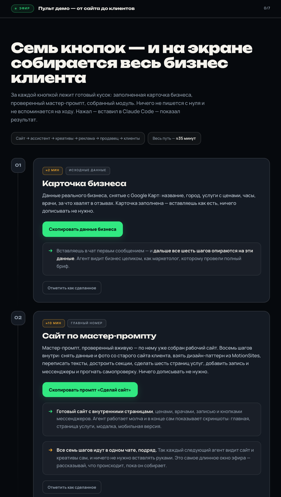

# STYLE-GUIDE · преза ефіру «AI-Оператор» (Влад Ясько)

Версія 1.0 · 21.09.2026 · складено за першими 150 слайдами `google180.html` (дані `js/slides-google180.js`, 342 слайди в масиві) плюс каталог нових layouts `s16-*` (154–183), якими збираються всі нові слайди.

**Для чого цей документ.** Щоб інша людина або агент зібрали нову продаючу частину (~40 слайдів) у тому самому стилі — так, щоб замовник (Мирослав) не правив кожен слайд. Тому тут не «настрій», а перевірювані значення: hex, cqw, класи, файли, тайминги, промпти, чекліст.

**Як перевірялось.** Прочитано HANDOFF/AGENTS/PLAN/контекст-файли, CSS/JS деки, `source/overrides.json`, промпт-логи генерацій; відрендерено headless Chrome усі слайди 1–150 (`shots/style-audit/s-001…150.png`, контакт-листи `shots/style-audit/contact/`) і вибірку 154–183 (`shots/style-audit/s16/`). Де документ і код/рендер розходяться — це зазначено в розділі 12.

**Пріоритет джерел істини:** нові прямі вказівки Мирослава → `CLAUDE-CONTEXT-2026-09-16-evening.md` (§3 «Правила смаку») → `AGENTS.md` → цей гайд → старі записи HANDOFF.

---

## 1. Суть стилю (10 рядків)

1. Це продаючий вебінар-реаліті для людей, які «вчора вперше відкрили ChatGPT». Слайди дивляться у WebinarStars поряд з відео спікера — екран не масштабується, тому все велике.
2. Формат **квадрат 1:1** (`?square`). 16:9 — лише допоміжний режим.
3. Палітра **чорно-жовта, тепла**: фон `#0B0907`, крем `#F5F3EE`, один акцент `#FDD506`. Зеленого й синього в дизайні немає; червоне — один штамп.
4. **1 слайд = 1 думка.** Заголовок російською, повний текст джерела, жодних скорочень «щоб влізло».
5. Заголовок — **Unbounded 500**, один кегль на весь заголовок; смисловий центр виділено **тільки кольором** (`<em>` жовтим). Пояснення — Manrope.
6. Візуал на кожному слайді: фото/відео на фон, предметний 3D-рендер, скетч, справжній скрин або SVG-схема. «Просто текст на фоні» — мінімум.
7. Картинка пояснює саме цю тезу, не «красива в стилі». Реальні докази (скрини, оплати, сайти) — тільки справжні.
8. Композиція спокійна: поля 7cqw, текст не на обличчях/руках/дрібному UI, нічого не обрізано, нічого не скупчено.
9. Рух короткий і скінченний: одна поява (≈1–2 с текст, ≤4 с сцена), потім статична фінальна композиція. Reduced-motion / `?frame` = одразу фінал.
10. Ніяких ознак «лендингового» стилю Ясько: без FIG/REV, без monospace-міток, без суцільного uppercase, без brutalist-декору. Емодзі немає — тільки SVG.

---

## 2. Кольори

Усі значення перевірені по CSS (`css/foundation.css`, `css/block-129-180*.css`, `css/block-154-163.css`, `css/surfaces.css`, `css/chapter-agents.css`). Частота в CSS: `#fdd506` ×415, `#f5f3ee` ×214, `#0b0907` ×153.

| Роль | Hex | Де саме |
|---|---|---|
| Фон слайда | `#0B0907` | усі сучасні блоки; на фон іде тихий жовтий radial 5–6.5% (нижче) |
| Текст основний / заголовки | `#F5F3EE` | `.b13-head h1`, `.s16-lead`, `.s16-cta` |
| Текст приглушений (пояснення, eyebrow) | `#C4BDB1` (s16), `#CEC9C1` (foundation), `#C6C1B9` (b129/life-story) | `.b13-body`, `.fd-body`, `.ls-body p` |
| Текст dim (підписи, осі, «сложность лёгкая») | `#8A8278`, `#7A726A`, `#6F685E`, `#8D877E` | `.s16-axis`, `.s16-cap`, `.s16-stg small`, `.fd-disc` |
| **Акцент** | `#FDD506` | `em` у заголовку, ключові слова, числа, лінії графіків, активні стани |
| Акцент пригашений (пройдені кроки, done) | `#7A6300`, `#5A4A10` (рамка активної картки), `#2A2410` (фон «lit») | `.s16-stg>div.done:before`, `.s16-eight i.on` |
| Лінії / сітка / рамки панелей | `#2A2420` (основна), `#3A3129` (рамки відео/фото-карток), `#393124` (розділювачі списків), `#2F2822` (рамка іконок) | `.s16-cell`, `.s16-vid`, `.fd-body li`, `.s16-list svg` |
| Панелі / плашки | `#15110D` (основна), `#1C1713` (плитка іконки, поле вводу), `#14110C` (ag-card), `#17130D` | `.s16-list>div`, `.s16-stg>div`, `.s16-input` |
| Іконки (штрих) | `#B3A996` на плитці `#1C1713` з рамкою `#2F2822`, радіус 1cqw, stroke 1.4 | `.s16-list svg`, `.s16-ico`, `.s16-card svg` |
| Червоне | `#C6000C` — лише штамп «ЭТОТ» на 163; `#FF5C6C` — HUD-крапка «live» (у `?clean` прихована) | не використовувати як акцент |
| Папір квитка (163) | `#F5ECD6` / чорнило `#2B2119`, `#7A6242` | одиничний виняток світлої плашки |

**Фоновий ambient** (не анімується): `radial-gradient(ellipse 55% 55% at 78% 67%, rgba(253,213,6,.065), transparent 82%), #0B0907` (`css/surfaces.css`); у foundation — `ellipse at 84% 88%, .055 → 55%`; у b129 — `#fdd50607 → 56%`. Це єдина «прикраса» фону: слабке тепле світло справа внизу.

**Правило одного акценту.** Жовтий — на 1 смисловому центрі заголовка + на числах/лініях/активному стані. Не фарбувати жовтим іконки (актуальне правило 16.09: іконки приглушені `#B3A996`; у старому блоці 79–129 іконки ще жовті — не повторювати). Не робити жовті заливки великих площ; суцільно-жовтих (інверсних) слайдів у поточній деці 1–150 немає (поле `theme:'light'` у даних 39/74 рендерером ігнорується — слайди темні). Дрібні жовті заливки дозволені: бейдж «ВЫ» (122), теги `$250` (173), кнопка-висновок «Только момент, когда вы начали» (147), цінник `$37 000` на фото (44), крапки прогресу.

**Що НЕ брати з `css/deck.css` `:root`.** Це легасі-палітра старого «aurora»-движка: `--bg:#070605`, `--muted:#9AA3AD` (холодний сірий), `--accent2:#FF9F1C`, `--amber:#FFB454`, `--screen:#5AA9FF`, `--danger:#FF5C6C`. Сучасні блоки їх перекривають; у нових слайдах ці змінні не використовувати.

**Зелений на скринах** (124 — графік з банку, 32 — ні) — допустимий тільки як частина справжнього доказу; в оформленні зеленого немає.

---

## 3. Типографіка

Шрифти локальні (`assets/fonts.css`, woff2, cyrillic+latin): **Unbounded** 500/700/800/900, **Manrope** 400–800, **JetBrains Mono** 400–600.

| Роль | Шрифт | Кегль (квадрат) | Інтерліньяж / трекінг | Колір |
|---|---|---|---|---|
| Заголовок слайда (s16, база для нових) | Unbounded 500 | `4.8cqw` (`.b13-head h1`), у layouts 3.7–5.2; авто-зменшення `.b13-long` (>76 знаків) у s16 **не діє** (перекрите базовим правилом; лише `s16-objection.b13-long` → 5.4) — довгий заголовок регулюємо кеглем layout'а і `<br>` | 1.18–1.25 / `-.03em` (foundation `-.047em`) | `#F5F3EE`, `em` → `#FDD506` |
| Заголовок у старих блоках | Unbounded 500 | foundation `4.35cqw`, ag-* `4.3cqw`, b129 `4.55cqw`, life-story `4.5cqh`, chapter-format `5.65cqw`; `fd-long-title` (>100 знаків) → 3.9 | 1.22–1.25 | те саме |
| Цитата серії «Узнаёте себя?» (5–13) | Unbounded 500 | `4.1cqh` (виняток 12 → 3.6cqh) — вся цитата одним кеглем | 1.22 / `-.04em` | крем, фрагмент жовтим |
| Гігантське слово/число | Unbounded 500 | `s16-num` 19cqw (155 «40%»), `s16-show em` 16cqw (160 «покажу»), codeword 14cqw (176 «АГЕНТ»), `big-num` 17cqw (31 «90%»), `s16-result` 8.2cqw (171 «$2.000»), `s16-sum` 7.4cqw | 1 / `-.05em` | жовтий |
| Числа на щільних числових слайдах | **Manrope** 700 | 148: 11.5cqw; 152: 20cqw | `-.055…-.06em` | 92 — крем, 170 — жовтий |
| Eyebrow / кікер (s16) | Manrope 500 | `2.4cqw` | 1 / `+.16em`, **uppercase** | `#C4BDB1`, відступ до заголовка 3cqh |
| Кікер (foundation, 5–13, 73) | Manrope 500 | `1.65cqw` / `2cqh` | без uppercase, зліва жовта риска 1.7–1.8cqw | `#CEC9C1` / `#BEB9B0` |
| Тіло / пояснення | Manrope 400 | `2.9cqw` (s16), 2.8 (ag, b129), 2.65cqh (life-story) | 1.42–1.48 / 0…`-.018em` | приглушений |
| Лід / висновок (`.s16-lead`) | Manrope 500 | `3.4cqw` (у `.s16-bottom` 2.6–2.9) | — | `#F5F3EE` |
| Заклик у чат (`.s16-cta`) | Manrope 500 | `3.2cqw`, зліва жовта смуга `.7cqw`, padding-left 2.5cqw | — | крем |
| Фінальна теза жовтим (`.s16-final`, `.ag-conclusion`) | Unbounded 500 | `3.25–3.4cqw` | `-.02…-.04em` | жовтий |
| Назва картки (`b` у картках) | Unbounded 500 | `2.3–2.6cqw` | 1.1–1.15 | крем |
| Номер кроку `01` | Unbounded 500 | `2.4cqw` | — | жовтий |
| Підписи, small | Manrope 400 | `1.8–2.1cqw` | 1.3 | `#C4BDB1` / `#8A8278` |
| Ціна-капсула (`.s16-price`) | Manrope 600 | `2.05–2.4cqw`, рамка 1px жовта, padding .8cqh 2cqw, без радіуса | — | жовтий |
| Таблиця (32, `.fd-table`) | Manrope 500 | th 1.65cqw, td 2–2.35cqw | — | th `#AAA49A`, перша колонка крем 650, числа жовті 700 |
| Дисклеймер | Manrope 400 | `1.2cqw` (`.fd-disc`) — легальний рядок, не для змісту | — | `#8D877E` |

Правила:

- **Один шрифт і один кегль у заголовку.** Акцент — тільки колір `<em>` (`font:inherit`). Не збільшувати фрагмент, не міняти накреслення. Перевірено на 5–13, 73, 92, 122, 154–177.
- **Дві родини на слайд максимум** (Unbounded + Manrope). На щільних числових сценах дозволений один Manrope (134 «Сегодня у меня одна цель» — Manrope 400/600; 148, 152, 153). JetBrains Mono на слайдах не використовується (лише HUD, який `?clean` ховає).
- **Uppercase** — тільки для eyebrow/дрібних технічних підписів (`.b13-eyebrow`, `.s16-what` «ЧТО СОБИРАЕТ АГЕНТ», `.s16-team .s16-sub` «ВАША КОМАНДА · 8 ЗАДАЧ», «ДО / ПОСЛЕ» на 209). Заголовки й тіло — у регістрі джерела (85 «МНЕ БУКВАЛЬНО СНЕСЛО КРЫШУ» — регістр Влада, не наш).
- **Явні переноси** `<br>` у `set.t` для лівих/довгих заголовків (`text-wrap:initial`), `text-wrap:balance` для центрованих. Не залишати сполучник/прийменник хвостом рядка («ради», «на»).
- **Жирне в тілі** — `strong`/`b` = крем 700 (не жовтий); жовтий у тілі — `em`/`.acc` тільки на 1 фразі.
- Мінімальний читабельний кегль для змісту — 2.4cqw; 1.8–2.1cqw лише для другорядних підписів.
- Лапки «…», тире —, числа `$2.000`, `$250–$1.200`, `40%`, `8×`, `1 007 942 UAH`. Нерозривні пари через `.nb`/`&nbsp;`.
- Кікер у даних `s.k` рендерер b129/s16 **не показує** — кікер задається в `foundation.block129.eyebrow` (у foundation-слайдах `s.k` виводиться як `.fd-kicker`).
- Якщо в `set.t` немає `<em>`, `foundation.js` (`accentTitle`) виділить сам: перше `$…`, `N%`/`N+`, «AI-агент», «AI-Оператор», «Claude», інакше — останні 1–2 слова. Тому `<em>` ставимо завжди явно.

---

## 4. Сітка й композиція

**Сцена.** `#stage{width:min(100vw,100vh);height:min(100vw,100vh);container-type:size}` — усі розміри в `cqw`/`cqh` (1% ширини/висоти квадрата; у квадраті вони рівні). Headless-рендер 900×900: заголовок 4.8cqw = 43px, тіло 2.9cqw = 26px, підпис 1.8cqw = 16px — це нижня межа для дрібного тексту.

**Поля.** Канонічно **7cqw з усіх боків** (правило Мирослава 16.09: «відступи зверху/знизу = лівому»). У коді: s16 базовий `.b13-shell{padding:8cqh 7cqw}`, `.s16-bottom{bottom:6cqh}`, новіші layouts `padding:7cqw 7cqw` (layers, case, team, four); foundation `7cqh 7.5cqw 6cqh`; b129 `7cqh 7cqw`; life-story `inset:7cqh 7cqw 20cqh` (низ під лінію життя). Для нових слайдів — 7cqw, елементи `.s16-*` абсолютні `left:7cqw; right:7cqw`.

**Зони (s16, згори вниз).**

1. `.b13-eyebrow` (2.4cqw uppercase, `margin-bottom:3cqh`) → `.b13-head h1` (центр за замовчуванням; зліва в `chart`, `map`, `quote`, `stages`, `layers`, `service`, `case`, `team`, `four`).
2. Головний візуал — абсолютний блок `top:21–31cqh`, висота 37–45cqh (`.s16-chart` 29/37, `.s16-vid` 27/38, `.s16-grid8` 29/38, `.s16-mx` top 23, `.s16-sg` 21→bottom 14).
3. `.s16-bottom` — `position:absolute; left/right:7cqw; bottom:5–6cqh`: 1–2 рядки: звичайний `p` (2.5–2.7cqw, приглушений) + `p.s16-lead` (крем 500) або `.s16-cta`.
4. Крапки кроків `.b13-step-dots` — `bottom:3cqh`, центр, `i` `.6cqw` `#857b513f`, поточна — жовта пігулка 2.2cqw.

**Варіанти компонування, які реально є в деці (з прикладами):**

| Патерн | Приклади | Як зроблено |
|---|---|---|
| Текст по центру на фото/відео-фоні | 15, 20, 22, 38, 39, 91, 107, 155, 157, 167, 177 | `.b13-art` на весь квадрат `object-fit:cover` + градієнт `:after` (розд. 7); текст угорі (`s16-text`) або внизу (`s16-bottom`), `text-shadow:0 2px 24px #0B0907` де над фото |
| Текст зліва, предмет/фото справа | 79, 81, 82, 165, 168 (телефон), 87/88/90 (фото зліва, текст справа) | `.b13-head{padding-right:40cqw}` + `.b13-art{right:0;width:54cqw}` з градієнтом 90°; або grid `minmax(0,1fr) 36–44cqw` |
| Картка зліва + текст справа | 171 (відео-картка 38cqw × 79cqh, заголовок `padding-left:47cqw`) | `.s16-card` radius 2.2cqw, рамка `#2f2822`, градієнт знизу 22% |
| Двоколонка порівняння | 73, 146, 147, 148, 119, 112 | `.duo .col` без заливки або з `rgba(11,9,7,.76)` + `backdrop-filter:blur(4px)` над фото (148); активна колонка — жовта рамка |
| Сітка карток 2×2 / 3×2 / 3×3 | 27 (3×2), 172 (2×2 вікна сайтів), 183 (2×2 медіа-картки), 168-items (3×2), 179 (1×2) | `.s16-fcard/.s16-tcard`: `#15110d`, рамка 1px `#2a2420`, radius 1.3cqw, медіа зверху `object-fit:cover`, підпис знизу з номером `01` |
| Список рядків 01–05 | 79, 114, 165, 168 (`.s16-three`), 145 | `grid-template-columns:5cqw 1fr`, розділювачі `border-top:1px solid #2a2420`, номер Unbounded жовтий |
| Список з іконками у 2 колонки | 169, 190–216 (`s16-icons`) | `.s16-list>div`: плашка `#15110d`, іконка 6.2cqw на плитці `#1c1713` |
| Таблиця | 32 (`.fd-table`), матриця 166 (`.s16-mx` 22cqw + 4×1fr, комірки 6cqh) | th дрібний приглушений, числа жовті, економія — жовта капсула |
| Велике число + пояснення | 25, 31, 103, 155, 148, 152, 173 | число Unbounded/Manrope 8–20cqw, підпис одразу під ним 2.8–3.3cqw, без декоративних барів |
| Схема/діаграма SVG | 19, 37, 38, 73, 74, 109, 113, 122, 139, 154, 174 | інлайн SVG у `b`, лінії `#fdd506` 2–4px, сірі базові `#7a726a`/`#8b8578`, сітка `#2a2420`; текст у SVG — `stroke:none` |
| Живе демо / iframe | 28, 84, 168 (телефон), 169 (артефакт на весь квадрат) | `.s16-phone` 390×790 масштабується `fitPhone()`, `.s16-demo iframe` inset 0; авто-скрол |
| Фотогалерея з лінією життя | 41–72 | `life-story`: пари/трійки/split; тонка жовта рамка `#fdd50655`, радіус `clamp(7px,1.2vmin,16px)`; лінія життя знизу 14cqh |
| Цитата + GIF-зона | 5–13 | текст у верхніх 6–44cqh, GIF-зона `left:10cqw top:49cqh 80×45cqw/cqh`, `fit:cover`, радіус 1.2cqw |

**Правило «нічого не обрізати, нічого не скупчувати».** Фото/скрин — `contain` або `cover` з підібраним `object-position`, але обличчя, суми, край документа видно; текст не лягає на обличчя, руки, дрібний інтерфейс, контрастну фактуру; між блоками ≥1.2–2cqh; після верстки перевірити 900px і 390px.

**Градієнти над фоновою картинкою** (`.b13-art:after`, s16 базовий):
```css
background:linear-gradient(180deg,#0b0907 0%,rgba(11,9,7,.85) 22%,transparent 55%),
           linear-gradient(0deg,#0b0907 0%,rgba(11,9,7,.8) 12%,transparent 34%);
```
Варіанти: `number` (155) `…88% 30% → .35 62% → transparent 100%`; `seven` (177) `…92% 26% → .45 50% → transparent 68%`; бічний (`layers`, `ag-art-full`) `linear-gradient(90deg,#0b0907 0%,rgba(11,9,7,.85) 22%,transparent 55%)`. Правило: затемнюємо тільки там, де лежить текст; праворуч унизу сцена лишається відкритою (пряма правка по слайду 1).

**Картинки з чорним фоном** (3D-іконки, скетчі на `#080706`): `mix-blend-mode:lighten` + `mask-image:radial-gradient(ellipse at center,#000 45%,transparent 72%)` — квадратів не видно (166 `.s16-hd img`, 168 `.s16-item img`, 82 `value-object`, 146 `.b13-compare-art`). Для предметів з обрізаним краєм — лінійна маска по краю (82, крок 1).

**Фото під текстом**: `filter:saturate(.92) brightness(.96)` (ag-bg-top), `saturate(.9)` (163); приглушені портрети на фоні — `opacity:.12–.18; filter:grayscale(1)` (114, 134). Не блюрити весь кадр і не ставити нижню маску там, де її прибрали (151).

---

## 5. Каталог layouts

Усі нові слайди збираються як `foundation.block129{kind:'s16', v2:true, layout:'s16-…'}` (розд. 5.5). Старі родини описані, щоб читати деку і не плутати класи.

### 5.1. Родини й де що лежить (перші 150)

| Слайди | Родина | Дані | Код |
|---|---|---|---|
| 1–26 | opening-сцени (`opening.scene`: intro, feeling, reveal/spotlight, participation-cue, story ×10, chapter ×3, chapter-visual ×3, chapter-format ×6) | `overrides.json` → ключ = заголовок → `opening{…}` | `js/opening.js`, `story-scenes`, `chapter-roadmaps`, `chapter-visuals`, `chapter-format`, `participation`, `s3-spotlight` + однойменні CSS |
| 27–32 | призи (`FoundationPrizes`) | `foundation.local 27–32` | `js/foundation-prizes.js`, `css/foundation-prizes.css` (`fp-27…fp-32`) |
| 33–40 | foundation базові + варіанти (`fd-meme-aside`, `fd-qr-billboard`, `route-roadmap` 35–36, `courseChangeDiagram` 37, `before-after` 38, `tools-workspace` 39, `story-start` 40) | `foundation.layout/variant` | `js/foundation.js`, `css/foundation.css`, `reality-route` |
| 41–72 | лінія життя (`fd:life-line`, 32 слайди) | `__lifeStory` | `js/life-story.js`, `css/life-story.css` |
| 73–78 | `early-entry`, `technology-waves`, `practice-centered`, `cocoon-*` | `foundation.variant` | `foundation.css`, `cocoon-frames.css` |
| 79–129 | `fd-ag-*` (блок «AI-сотрудники → метод», ~60 варіантів) + `AgentSteps` | `foundation.variant:"ag-… ag-…"` (кілька класів через пробіл) | `css/chapter-agents.css`, `js/agents-steps.js`, `slide-123-orbit`, `value-stages` |
| 129–150 | block129 (`kind` + `layout`, v2) і сцени під конкретні слайди | `foundation.block129` | `js/block-129-180.js`, `js/block-129-180-v2.js`, `css/block-129-180*.css`, `slide-133-levels`, `participant-story`, `opportunity-studio`, `slide-three-eras`, `service-era-3d`, `slide-two-roads`, `slide-jobs-background`, `wave-cinema` |
| 154–183+ | **`s16-*`** | `foundation.block129{kind:'s16'}` | `css/block-154-163.css`, `js/block-154-163.js` |
| 170–260 | `fd-mc-*` (механізм, кейси) | `foundation.variant` | `css/chapter-mechanism.css` |
| sales.html | `fd-sl-*` (перша версія продаючої частини, Google 316–352) | `source/sales/build_sales.py` | `css/chapter-sales.css` |

Статистика 1–150: `foundation.layout` editorial 63, life-line 32, statement 6, media 5, cards 4, comparison 4, chat 2, metric 2, route-roadmap 2, service-era-3d 2, diagram 1, split 1; opening 26; block129 у 17 слайдах; `fd-ag-*` — 49 слайдів (79–128 без embed-84).

### 5.2. Foundation (`.slide.foundation.fd-<layout>.fd-<variant…>`)

DOM: `.fd-shell > header.fd-header (.fd-kicker? + h1.split-done) + .fd-content > .fd-body (html з b) [+ figure.fd-media.fd-media-N > div > img/video]`. `layout`: `editorial` (за замовчуванням), `statement` (центр, h1 5.5cqw, `p.acc` з лівою жовтою рискою), `media` / `split` (автоматично, коли є `media[]`: >240 знаків → split), `cards` (3+ абзаци → `.fd-paragraph-cards`), `comparison`, `chat` (`.chatbox .cmsg[.me]`), `metric` (`.big-num` 17cqw), `diagram`, `embed` (iframe або `demoPreviews` + «Открыть демонстрацию»), `source` (растр джерела `contain`). Медіа: `fd-media` радіус 1.3cqw, `object-fit:contain`; `mediaCrop{x,y,w,h}` — кроп CSS-ом. Поява: header `.52s`, діти тіла `.48s` з кроком `.09s`.

### 5.3. `fd-ag-*` (79–129) — коротко

Центровані тези: `ag-statement`, `ag-pause` (+`.ag-final` у рамці), `ag-shout`, `ag-insight` (кікер великими + теза Unbounded 4.2), `ag-question`, `ag-chapter` (іконка 13cqw + h1 6.2), `ag-hidden`. Рядки: `ag-rows` (`.ag-row`: номер 2.35cqw Unbounded + `.ag-lead` 3cqw + `.ag-text` 2.5), `ag-not-needed` (рядки з ✕). Схеми: `ag-convergence` (лінії сходяться до вузла 27cqw), `ag-flow3`, `ag-method-flow`, `ag-roadmap3`, `ag-orbit` (122). Докази: `ag-proof-wide` (фігура 60cqh), `ag-document-split` (+`ag-mirror`, `ag-doc-wide`), `ag-portrait-split`, `ag-chat` (з аватарами, «АГЕНТ · ОНЛАЙН»), `ag-kruzhok`, `ag-phone-video`, `ag-site-video`, `ag-metric-growth` (лічильник `.ag-count[data-from][data-to]`). Фото/арт: `ag-full-photo`, `ag-bg-top/bottom/left`, `ag-side-art`, `ag-art-full`, `ag-bg-art`, `ag-two-states`, `ag-split-photos`, `ag-photo-caption`, `ag-pair-caption`, `ag-pair-wide`. Кроки: `ag-steps-sketch` (стійка `.ag-sketch-stage img[data-step]`), `ag-cards-deck`, `ag-reframe-deck`, `ag-five-columns`, `ag-two-panels`, `ag-scale`. Спільні токени: `--ag-line:rgba(253,213,6,.3)`, `--ag-radius:1.4cqw`, `--ag-card:#14110C`. Кроки: `<div class="ag-stepper" data-steps="N" [data-auto="1"] [data-exclusive] [data-carousel] [data-orbit]>` + елементи `[data-step="k"|"final"]`.

### 5.4. block129 (129–150)

`foundation.block129{kind, v2:true, layout, art:[{src,alt}], eyebrow, steps:[…], focus:'селектор', reverseFocus, demoURL, sound, segment}`. DOM: `.slide.foundation.b129.b13-<kind>.b13-g<google>[.b13-long] > .b13-shell > header.b13-head (p.b13-eyebrow + h1) + .b13-body` + (v2) `.b13-art > .b13-art-frame.is-current > img` (prepend) + `.b13-step-dots`. Layouts, що є в 1–150: `native` (129/130 пара фото з підписом унизу; 140 split), `day-scene` (133, 2 кроки, 2 арти вечір/ранок), `goal-chain` (134, 3 рядки з іконками, один Manrope), `secrets-levels` (135, 3D-«поверхи»), `participant-story` (136, 5 кроків, метрика 11cqw), `studio-loop` / `studio-quote` (137/138: SVG-студія з роботами; цитата на скляній плашці `backdrop-filter:blur(3px)`), `opportunity-3d` (139, три рядки з 3D-SVG 25cqw), `portal` (141, скетч дверей), `photo-eras` (142, 1995/2010/2026), `service-era-3d` (143/144), `sketch-steps` (145, гаманець + 3 кроки), `visual-compare` (146), `roads` (147, права колонка жовта), `jobs` (148, 92/170 млн на фото), `wave-cinema` (149/150, постер → відео). Решта v2-layouts у CSS (`goal-focus`, `editorial-art`, `dark-quote`, `metric-art`, `templates-real`, `service-table`, `departments-art`, `money`…) — для 151–180, не в цьому обсязі.

### 5.5. `s16-*` — актуальний конструктор (усі нові слайди)

Спільне: `.b129[class*="b13-v2-s16-"]` — шелл `8cqh 7cqw`, заголовок Unbounded 500 4.8cqw центр, eyebrow uppercase, тіло Manrope 2.9cqw `#c4bdb1`, `.b13-art` на весь квадрат + градієнт, `.s16-text`/`.s16-bottom` абсолютні на 7cqw. `steps` + `focus:'.s16-step'` → показується лише `.s16-step.is-focus`. Клас `s16-play` при вході запускає CSS-анімації; `s16-static` — фінал (reduced-motion, `?frame`, вхід назад). Приклад патч-скрипта: `source/_patch_164_vlad.py` (функція `slide(oid,t,b,layout,art,eyebrow,extra)`).

| Layout | Що робить | Очікувана розмітка `b` | Кроки/рух | Приклад |
|---|---|---|---|---|
| `s16-chart` | заголовок зліва + SVG-графік (жовта лінія vs сіра база) + легенда + 2 абзаци внизу | `.s16-chart>svg` (`.s16-grid`, `.s16-axis text`, `.s16-area` fill `url(#s16-ga)`, `.s16-base`, `.s16-line`, `circle`), `.s16-legend span i`, `.s16-bottom p (+ .s16-lead)` | без кроків; лінія — статична (кадр) | 154 |
| `s16-number` | гігантське число на фото | `art[1]`; `.s16-text > .s16-num + p.s16-lead (nowrap) + p.s16-sub` | — | 155 «40%» |
| `s16-map` | заголовок зліва, `p.s16-intro`, карта `contain` знизу (`scale(.86)`), CTA | `art[1]`; `p.s16-intro`, `.s16-bottom > p.s16-cta` | — | 156 |
| `s16-quote` | заголовок зліва, `em` окремим блоком 6.6cqw; фото; підпис унизу | `art[1]`; `.s16-bottom p` | — | 157 |
| `s16-split` | заголовок 5cqw центр над двочастинним артом; підписи в кутах | `art[1]`; `.s16-labels>span+span` (другий жовтий) | — | 158 |
| `s16-objection` | велика цитата 6cqw (long 5.4) над приглушеним фото; eyebrow «Убеждение N» | `art[1]`; тіло порожнє | — | 159, 162 |
| `s16-show` | «Сейчас я просто» Manrope + гігантське `em` Unbounded 16cqw + підкреслення + курсор | `span.s16-underline` + `.s16-cursor>svg` | underline .6s@.5s, курсор 1s@.4s | 160 |
| `s16-chat` | `em` блоком 7cqw + `p.s16-lead` центр над предметним фото | `art[1]`; `p.s16-lead` | — | 161 |
| `s16-game` | мультяшна вітрина + квиток-замовлення з чекбоксами, штамп «ЭТОТ», станції | `.s16-glow`, `.s16-ticket>h4 + .s16-row[.win]>.s16-box + .s16-stamp`, `.s16-cursor`, `.s16-stations>span×4`, `.s16-bottom` | сцена 3.8 с: квиток .7s@.3 → курсор 1.6s@1 → чекбокс @2.2 → штамп @2.5 → станції @3 → текст @3.3 | 163 |
| `s16-stages` | заголовок зліва + відео/4 кадри 38cqh + 4 картки з жовтою верхньою смугою + прогрес | `.s16-vid>video[muted loop]` або `img×4`; `.s16-stg>div>b+small`; `.s16-bottom` | `segment:3` — картка `.on` синхронізується з `currentTime`; клік по картці перемотує | 164 |
| `s16-layers` | заголовок зліва (`padding-right:40cqw`), список 01–05 у плашках, 3D-стос справа | `art[1]` (right 0, 54cqw); `.s16-lay>div>b+div>span+small`; `.s16-bottom{right:46cqw}` | — | 165 |
| `s16-matrix` | таблиця 5×4 з 3D-іконками в шапці, жовті крапки | `.s16-mx`: порожній `div`, `.s16-hd>img+b`×4, потім ряди `.s16-rl` + `.s16-cell>i[style=--transition-delay]`×4 | крапки з'являються з `transition-delay` 300ms+70ms | 166 |
| `s16-vlad` | фото Влада на фон (2 градієнти), eyebrow, заголовок 5cqw, текст внизу | `art[1]`; `.s16-bottom>p + p.s16-lead` | — | 167 |
| `s16-items` | сітка 3×2 предметів (lighten+mask) із кроками, ціна внизу | `.s16-grid>.s16-item>img+b+small`; `.s16-bottom>span.s16-price+p`; `steps:[…], focus:'.s16-item'` | фокус: `.is-focus` 1/1, решта .4 scale .94 | — (у даних зараз не використовується; був перший варіант 168) |
| `s16-service` | 01–03 зліва + живий мобільний сайт у рамці телефону справа + ціна | `p.s16-what`, `.s16-three>div>b+span`, `.s16-bottom>span.s16-price`, `.s16-phone>iframe[src=./assets/sites/…/index.html]` | авто-скрол iframe 0.09 px/ms, bounce, старт 1.2 с; відпускається при взаємодії | 168 |
| `s16-icons` | крок 1: список з іконками (1 або 2 колонки); крок 2: демо-артефакт iframe на весь квадрат (заголовок ховається) | `.s16-step>.s16-list[.one]>div>svg+span` + `.s16-step>.s16-demo>iframe[src=assets/artifacts-1409/<x>.local.html]` + `p.s16-demo-link`; `steps:['Что делает агент','Живое демо агента'], focus:'.s16-step'` | демо: авто-скрол 0.14 px/ms від 3%, без bounce | 169, 190, 198, 206, 216, 221 |
| `s16-video` | програвач 16:9 (top 24 → bottom 9cqh) + підпис; або крок 1 картки `.s16-list>div>b` + ціна, крок 2 плеєр | `.s16-player>video[playsinline preload=metadata poster=./…]`, `p.s16-cap`; `sound:true` | відео зі звуком у фокусному кроці | 194, 199, 225 |
| `s16-ba` | дві відео-панелі «До / После» (1.45fr 1fr) з ярликами | `.s16-pair>div[.after]>video+span`, `p.s16-cap` | обидва відео muted loop | 209 |
| `s16-cover` | відео-«стрічка» по діагоналі −45°, opacity .55, заголовок по центру, без градієнта | `.s16-cover>video×2` | loop | 170 |
| `s16-case` | вертикальна відео-картка зліва + результат справа: eyebrow, ім'я, цитата, `$2.000` 8.2cqw, шлях 2–3 рядки | `.s16-card>video[poster]`, `p.s16-quote`, `.s16-result>b+span`, `.s16-path>div>b+текст`; `sound:true` | `s16-up` .7s: h1 → quote .15 → result .3 → рядки .5/.65/.8; картка .9s | 171 (шаблон для кейсів людей) |
| `s16-sites` | 2×2 «вікна браузера» з повними скринами сайтів, що повільно прокручуються; підписи | `.s16-sg>figure>.s16-win>img[style=--travel:-88%;--dur:24s][.s16-still]+figcaption>назва+small` | `s16-pagescroll` linear infinite alternate; `s16-static` зупиняє | 172 |
| `s16-calc` | 8 клієнтів (SVG-аватари 12cqw) з тегами `$250` + рівняння одним рядком + сума 7.4cqw | `.s16-grid8>.s16-cl>svg+b`, `.s16-eq> b/small/.s16-sum`, `p.s16-sub` | pop .5s з кроком .25s; теги +.3s | 173 |
| `s16-flow` | 8 людей (3 «lit»), криві до 3 карток з цінами | `p.s16-lead2`, `.s16-eight>i[.on][style=--d]`, `svg.s16-flowsvg>path[pathLength=1]`, `.s16-cards>.s16-card>svg+b+small+.s16-pr+.s16-pm[.month]`, `.s16-ping` | lit .5s@.9/1.15/1.4 → лінії 1s@1.6–1.9 → картки .6s; `ping` пульсує 2.4s | 174 |
| `s16-year` | 3D-площина 12 місяців зі стовпчиками (є в CSS, у даних зараз не використовується — замінений `s16-flow`) | `.s16-stage>.s16-plane>.s16-m + .s16-bar>i.site/.sell/.seo/.ads`, `.s16-cap`, `.s16-leg` | JS `runYear`: місяць кожні 520ms | — |
| `s16-codeword` | слово 14cqw по літерах + інструкція + чат ефіру зліва + скрин праворуч (повільний скрол) | `t:'<em>АГЕНТ</em>'`; `p.s16-sub`, `.s16-chat>.s16-msgs>.s16-msg[.me][style=--d]>i+span` + `.s16-input>.s16-txt>span+b + .s16-send>svg`, `.s16-frame>img` | літери .09s; повідомлення за `--d`, далі JS «крапає» нові кожні 0.9–1.8 с | 176 |
| `s16-seven` | AI-фон (сім вітрин) + текст стовпчиком зверху (`padding-top:20cqh`), Ken Burns | `art[1]`; `.s16-text>p×N + p.s16-final` | абзаци .7s @.45/.65/1.1; `s16-kb` 14s scale 1.06→1 | 177 |
| `s16-team` | eyebrow + `p.s16-sub` uppercase + 2 медіа-картки (img/video/«віяло» скринів) з іконкою і назвою; прогрес-смужки | `.s16-team>.s16-tcard>.s16-media[.fit][.light][.s16-fan]>img/video + .s16-txt>svg.s16-ico+div>b+small`; `.s16-progress>i[.on][.done]` | картки `s16-up` 0/.25s | 179–182 (`presentationParts` 4 частини) |
| `s16-four` | 2×2 медіа-картки з номерами 01–04; штрихований плейсхолдер `.s16-ph` для відсутнього візуалу | `.s16-four>.s16-fcard>.s16-media[.fit|.s16-ph]>… + .s16-txt>span.s16-n+span` | картки 0/.2/.4/.6s | 183 |

**Загальні класи s16:** `.s16-bottom`, `.s16-text`, `.s16-lead` (3.4cqw крем 500), `.s16-cta` (жовта смуга), `.s16-price` (капсула), `.s16-cap` (2.1cqw dim), `.s16-step`, `.s16-demo`, `.s16-phone`, `.s16-list[.one]`, `.s16-player`, `.s16-card`, `.s16-media[.fit|.light|.s16-ph]`, `.s16-ico`.

**Іконки:** інлайн SVG `viewBox="0 0 24 24"`, тільки штрих (`fill:none;stroke-width:1.4;stroke-linecap:round;stroke-linejoin:round`), 1–2 шляхи, без тексту; набір з 18 штук — у `source/_patch_164_vlad.py` (`ICONS[]`). Нові іконки малювати в тому самому дусі; не жовті.

### 5.6. Рецепти для нової продаючої частини (~40 слайдів)

Структуру аргументів брати з джерела Влада (Google-дека продаючої частини, дизайн `prodayushchaya-chast/hvost-efira-ai-operator.html` у зіпці) і з попередньої версії `sales.html` (`fd-sl-*`: стек цінності з лічильником 320, велика сума 328, стовпчики 18→21→27 (329), три набори 330, ціна 331, кнопка броні 332, шлях оплати 333, чотири вузли 343, вибір із двох 345, заперечення→відповідь 347, «після 45 днів» 348, п'ять артефактів 350, екран Q&A 351, фото на весь кадр 318/341/352). Оформлення — тільки мовою `s16-*`:

| Тип продаючого слайда | Layout / компоненти | Медіа | Рух | Обмеження |
|---|---|---|---|---|
| Перехід до оффера («А дальше — проще», «Что вы получаете») | `s16-seven`-патерн: AI-фон знизу + текст стовпчиком зверху (`padding-top:20cqh`), `p.s16-final` жовтим | 1 генерація-фон з порожнім верхом 55% | абзаци `s16-up` .45/.65/1.1 с, легкий Ken Burns | без людей у генерації; жодних цифр у фоні |
| Стек цінності (що входить) | список 01–0N у плашках як `.s16-lay` (`s16-layers`), арт справа опційний; підсумок у `.s16-bottom` | предметний 3D-стос або без арту | рядки по черзі `s16-up` з кроком .15 с; лічильник — лише якщо суми є в джерелі | не додавати «вартість» пункту, якої немає у Влада |
| Пакети / тарифи (3) | картки як `.s16-cards>.s16-card` із `s16-flow` (без «восьми людей» і кривих): назва Unbounded 2.4, `small`, ціна `.s16-pr` жовта, підпис `.s16-pm` uppercase; активний/рекомендований — рамка `#fdd506` | — | картки 0/.2/.4 с | один виділений пакет; назви наборів звірити з джерелом (у джерелі були розбіжності «Старт · Мастер · Агентство одного» vs «Старт, Рост, Максимум») |
| Чотири складові / бонуси | `s16-four` (2×2 медіа-картки з `01–04`) або `s16-team` (1×2 з іконкою і назвою) | реальні скрини/відео; якщо немає — `.s16-ph` «визуал позже» | картки з кроком .2 с | не генерувати «схожий» скрин продукту |
| Ціна | `s16-number` (число 19cqw на спокійному фото) або рівняння `.s16-eq` з `s16-calc` («N × $… = $…»), стара ціна — `<s>` як у 32 | фон-генерація або без | одна поява | числа тільки з джерела; без вигаданих «знижок» |
| Порівняльна таблиця | `.fd-table` (32): th 1.65cqw `#AAA49A`, td 2–2.35cqw, числа жовті 700, економія — жовта капсула | — | рядки по черзі (foundation `fd-enter`) | ≤6 рядків, ≤4 колонки |
| Гарантія / «после 45 дней» | `s16-quote` або `s16-objection`: цитата великим на спокійному фото, відповідь у `.s16-bottom` крем 500 | фон-генерація (порожній верх 45%) | — | без «гарантій доходу»; дисклеймер `disc:true` де потрібно |
| Заперечення → відповідь | `s16-objection` (eyebrow «Возражение N», цитата 6cqw) + відповідь `.s16-bottom p.s16-lead`; або `s16-icons` `.s16-list.one` для переліку | тихе фото зі спини/предмет | — | одне заперечення на слайд |
| Кейс учня | `s16-case` (вертикальне відео або фото у `.s16-card`, `sound:true` для відео; справа eyebrow, ім'я, цитата, результат 8.2cqw, шлях 2–3 рядки) | `assets/video/kejsy-1409/`, фото людини реальне | `s16-up` каскад .15/.3/.5/.65/.8 | імена/суми — слова людини з джерела; без відео → `img` замість `video` |
| Кодове слово / бронь | `s16-codeword` (слово 14cqw, інструкція `.s16-sub`, чат зліва, скрин справа) | скрин екрана оплати/бота | літери .09 с, чат «крапає» | посилання — `window.CTA_URL` (плейсхолдер `#ОПЛАТА` до отримання) |
| Кнопка / CTA | один жовтий блок на слайд: `background:#fdd506;color:#0b0907;font:600 2.6cqw Manrope` (як 147 «Только момент, когда вы начали»), над/під ним `.s16-cta` | — | поява останньою | не більше однієї заливки на слайд |
| Шлях оплати / дедлайн | `s16-stages`-патерн: 4 картки з жовтою верхньою смугою + прогрес; або велике число днів `s16-number` | скринкаст екрана оплати (якщо є) | картки `.on` по кроках | не показувати «Платеж обрабатывается» як оплачено |
| Артефакти ефіру (5 зон) | `s16-sites` (2×2 «вікна») + одна `s16-service`-подібна вітрина, або `s16-four` з `.s16-ph` | реальні скрини артефактів | повільний скрол | заглушки лишаються заглушками до матеріалів Влада |
| Фото зали/сцени з тезою | `s16-vlad`-патерн (фото на весь квадрат, текст зверху+знизу) | `assets/photo/stage-*`, `assets/photo/sales/` | — | обличчя не під текстом |
| Q&A / «пишите вопросы» | `s16-icons` крок 1 (`.s16-list.one`) або `s16-chat`-патерн (велике `em` + `p.s16-lead`) | предметне фото | — | — |

Ритм блоку: після 2–3 «щільних» слайдів (стек, таблиця, пакети) — пауза-теза на фото; кейси — не більше трьох підряд; кнопка/кодове слово — не частіше ніж раз на 6–8 слайдів.

### 5.7. Як додати новий `s16-*` layout

1. Назва `s16-<slug>` → у CSS клас `.b129.b13-v2-s16-<slug>`; базові правила `[class*="b13-v2-s16-"]` (шелл, заголовок, eyebrow, арт, `.s16-bottom`) застосовуються автоматично.
2. Кожна анімована властивість має **два стани**: `.s16-play` (keyframes) і `.s16-static` (фінальні значення), інакше `?frame`/reduced-motion/повернення назад покажуть порожній слайд.
3. JS потрібен тільки для логіки (sync відео, лічильники, авто-скрол) — розширювати `B.enter/advance/finish` у `js/block-154-163.js` з перевіркою `el._b13.layout==='s16-<slug>'`.
4. Секцію в CSS підписувати `/* NNN · назва */`, як існуючі; після змін — `?v=` в `index.html` і `google180.html`.

Скелет CSS (три картки з цінами, поява по черзі):
```css
/* NNN · s16-offer: три набори */
.b129.b13-v2-s16-offer .b13-head h1{font-size:4.6cqw}
.b129.b13-v2-s16-offer .s16-cards{position:absolute;left:7cqw;right:7cqw;top:27cqh;z-index:3;display:grid;grid-template-columns:repeat(3,1fr);gap:1.6cqw}
.b129.b13-v2-s16-offer .s16-card{position:relative;background:#15110d;border:1px solid #2a2420;padding:1.8cqh 1.6cqw;text-align:center;opacity:0;transform:translateY(2cqh)}
.b129.b13-v2-s16-offer .s16-card.is-main{border-color:#fdd506}
.b129.b13-v2-s16-offer .s16-card b{display:block;margin:1cqh 0 .4cqh;font:500 2.4cqw Unbounded,sans-serif;color:#f5f3ee}
.b129.b13-v2-s16-offer .s16-card small{display:block;font:400 1.8cqw/1.3 Manrope,sans-serif;color:#c4bdb1;min-height:4.8cqh}
.b129.b13-v2-s16-offer .s16-card .s16-pr{display:block;margin-top:1cqh;font:500 2.8cqw/1 Unbounded,sans-serif;color:#fdd506;white-space:nowrap}
.b129.b13-v2-s16-offer .s16-card .s16-pm{display:block;margin-top:.5cqh;font:500 1.7cqw Manrope,sans-serif;color:#6f685e;letter-spacing:.12em;text-transform:uppercase}
.b129.b13-v2-s16-offer.s16-play .s16-card{animation:s16-up .6s cubic-bezier(.2,.8,.2,1) forwards}
.b129.b13-v2-s16-offer.s16-play .s16-card:nth-child(2){animation-delay:.2s}
.b129.b13-v2-s16-offer.s16-play .s16-card:nth-child(3){animation-delay:.4s}
.b129.b13-v2-s16-offer.s16-static .s16-card{opacity:1;transform:none}
.b129.b13-v2-s16-offer .s16-bottom{bottom:5cqh;text-align:center}
```

Скелет патча (за зразком `source/_patch_177_seven.py`):
```python
import json
p='source/overrides.json'; o=json.load(open(p)); va=o['__visibleGoogleAudit']['slides']
oid='<googleObjectId>'                       # шукати за objectId, не за номером
s=va.get(oid) or {}
s['reason']='<дата> Мирослав: <що обрано і чому>. Повний текст джерела.'
s['mediaStatus']='ready'                     # або 'needed', якщо стоїть заглушка
rm=s.setdefault('remove',[])
for k in ['bg','photos','src','kind','poster','opening','viz','theme','fx','lost','bgside','ptall','img','k']:
    if k not in rm: rm.append(k)
st=s.setdefault('set',{})
st['t']='Три набора — <em>на выбор</em>'    # точний текст джерела, <em> і <br> явно
st['b']=('<div class="s16-cards">'
         '<div class="s16-card"><b>Старт</b><small>…</small><span class="s16-pr">$…</span><span class="s16-pm">…</span></div>'
         '<div class="s16-card is-main">…</div><div class="s16-card">…</div></div>'
         '<div class="s16-bottom"><p class="s16-lead">…</p></div>')
f=s.setdefault('foundation',{})
f.update({'type':'content','local':0,'sourceOnly':False,'omitMedia':True,'media':[],'mediaNeeded':False,
          'mediaBrief':'<укр. опис візуалу>','animationBrief':'<укр. опис руху>'})
f.pop('variant',None); f.pop('layout',None)
f['block129']={'kind':'s16','v2':True,'layout':'s16-offer','eyebrow':'Предложение'}
va[oid]=s
json.dump(o,open(p,'w'),ensure_ascii=False,indent=1)
```
Після патча: `FOUNDATION_SOURCE=… python3 source/_foundation_prepare.py && python3 source/_build_slides.py`, скрін `?frame` і без `frame`, порівняти, що змінився лише цей objectId.

---

## 6. Рух

**Принцип.** Рух пояснює одну дію або переносить увагу; після нього композиція нерухома. Немає нескінченних декоративних анімацій. Слайд 1 = один клік → наступний; кроки (`steps`) — тільки там, де вони частина концепції (164, 168, 169, 171-подібні кейси — ні; 176 — ні).

**Тайминги, які реально в коді.**

| Механіка | Значення | Де |
|---|---|---|
| Перехід слайда | `slideIn .75s` / opening `.48s` / life-story в'їзд `.64s` з ±14cqw, вихід `.46s` | deck.css, opening.css, life-story.css |
| Foundation поява | header `.52s`; діти тіла `.48s`, затримка `.12s + .09s×порядок` (max 12); медіа `.6s@.3s` | foundation.css `fd-enter` |
| Opening story (5–13) | текст `.62s@.08s`, GIF-зона `.7s@.14s`; повернення назад `.18s` | story-scenes.css |
| s16 поява рядків | `s16-up .6–.9s cubic-bezier(.2,.8,.2,1)`, крок між елементами `.15–.25s`; каскад закінчується за 1.5–1.8 с (case: останній рядок .8s+.7s; seven: 1.1s+.7s) | block-154-163.css |
| s16 сцени (game, calc, flow, codeword) | 2.4–3.8 с, далі статика | там само |
| block129 v2 (WAAPI) | head 550ms; арт 1050ms@100; блоки 620ms@130+80i; бари 1200ms@250+230i; SVG-лінії `strokeDashoffset` 1200ms@200+70i; крапки 420ms@250+17i; зміна кроку 420ms; зміна арту 560ms | block-129-180-v2.js `motion()` |
| Ken Burns на фоні | `scale(1.06)→1`, 14s linear, один раз | `s16-seven` |
| Авто-скрол скринів у «вікнах» | `translateY(0→var(--travel))`, `--dur` 23–26s, linear, infinite alternate | `s16-sites`, 176 `.s16-frame img` (16s ease-in-out, старт 3s) |
| Авто-скрол iframe | телефон 0.09 px/ms, bounce, старт 1200ms; демо 0.14 px/ms, старт з 3%, без bounce, 900ms; відпускається на wheel/touch/pointer/key | block-154-163.js `startAutoScroll` |
| Синхронізація відео↔картки | `segment` секунд на картку; `timeupdate` → `.on/.done`; прогрес-бар `.s16-prog` | 164 |
| Лічильники | `.ag-count[data-from][data-to][data-dur=1800][data-delay=600]` (104); `runYear` 520ms/місяць | agents-steps.js, block-154-163.js |
| Чат (176) | повідомлення за `--d` 3.3–7.3s; далі JS додає «агент/Агент/АГЕНТ» кожні 900–1800ms, у боксі ≤10 | `runChat` |
| Блимання | каретка `s16-blink` 1s, «ping» 2.4s — єдині дозволені цикли (дрібні) | |

**Стани.** `B.enter(el,dir)`: усі `video` у `.s16-pair/.s16-vid/.s16-cover/.s16-team/.s16-four` → `muted, currentTime=0, play()`; `fitPhone`, `liveFrames`; знімає `s16-play/s16-static`; якщо `prefers-reduced-motion` або `?frame` або `dir<0` (прийшли з наступного слайда) → `settle()` = `s16-static` (усе у фіналі, таймери зупинені, чат у повному складі); інакше `s16-play`. `B.advance` → наступний `.s16-step`, `stepMedia` запускає відео фокусного кроку (`sound:true` → зі звуком, fallback muted). `B.finish` → фінал. Крапки кроків і підказка «Крок n / N · назва» у нотатках спікера (клавіша N).

**Що анімуємо, а що ні.** Анімуємо: появу рядків по черзі, промальовку ліній SVG, зміну фокуса, підсвітку одного елемента, синхронізацію відео, авто-скрол демо. Не анімуємо: масштаб фото з вписаним текстом, «перетікання» елементів між слайдами (відхилено на 2→3), перестановку предметів (відхилено на 3), декоративні орбіти/частинки (легасі aurora вимкнено на всіх сучасних слайдах).

**Бібліотека keyframes `s16-*` (перевикористовувати, не плодити нові):**

| Keyframe | Що робить | Типовий виклик |
|---|---|---|
| `s16-up` | `opacity:0; translateY(2cqh)` → видно | `animation:s16-up .6–.9s cubic-bezier(.2,.8,.2,1) both` + `animation-delay` каскадом |
| `s16-fade` | → `opacity:1` | другорядні шари (`.s16-glow`, `.s16-stations`, `.s16-bottom` у сценах) |
| `s16-pop` | → `opacity:1; scale(1)` з пружним `cubic-bezier(.3,1.5,.5,1)` | аватари, чекбокси |
| `s16-tag` | → `opacity:1; transform:none` | бейджі `$250` над елементом |
| `s16-draw` | → `opacity:1; stroke-dashoffset:0` (path з `pathLength="1"`, `stroke-dasharray:1`) | лінії схем |
| `s16-lit` / `s16-litfill` | підсвітка елемента жовтим (фон `#2a2410`, рамка `#fdd506`, тінь) | «обрані» з ряду |
| `s16-grow` | `scaleX(0→1)` від лівого краю | підкреслення |
| `s16-letter` | `opacity:0; scale(1.35); blur(.8cqw)` → норма | гігантське слово по літерах (`--d` .35 + .09·i) |
| `s16-kb` | `scale(1.06→1)` 14 с linear | Ken Burns фону |
| `s16-pagescroll` | `translateY(0 → var(--travel))`, `var(--dur)` linear infinite alternate | скрини сайтів у «вікнах» |
| `s16-ticket`, `s16-stamp`, `s16-cursor-game`, `s16-cursor-show` | сценічні (квиток в'їжджає, штамп «ЭТОТ», курсор летить) | 163, 160 |
| `s16-type`, `s16-vanish`, `s16-blink`, `s16-sendon/off`, `s16-ping` | набір тексту `clip-path` steps(5), зникнення, каретка, кнопка «надіслати», пульс бейджа | 176, 174 |

Правила застосування: `both`/`forwards`, easing `cubic-bezier(.2,.8,.2,1)`; каскад через `animation-delay` або `--d`; для кожної анімації — дзеркальне правило у `.s16-static`.

**Reduced motion / `?frame`.** `@media(prefers-reduced-motion:reduce)` → `animation:none!important` у всіх сучасних CSS; відео показують `poster`. `?frame` фіналізує `s16-*`, block129 v2 і `participant-story`. **Не фіналізує** `.ag-stepper` (79–129) і spotlight (3): скрін показує крок 1 (перевірено на 3, 115, 120). Для таких слайдів статичний кадр знімати після кліків або описувати фінал окремо.

---

## 7. Картинки, відео, скріни

### 7.1. Звідки беремо (пріоритет)

1. **Матеріали Влада** із зіпки `PREZA-AI-Operator-proekt-1409.zip` → уже скопійовано в `assets/vlad-1409/` (`uslugi/` скрини сайтів full-page + дашборди, `kejsy/` відео кейсів, `pult/` пульт демо, `umeete/`, `brands/`, `video/` ролики з постерами `*-1080.mp4`). Особисті фото/скрини з Google-деки — `assets/google-source/` (132 файли), `assets/photo/{vlad,vlad2,office-*,stage-*,kejsy,uslugi,sales}`, відео `assets/video/`. Google-експорт `source/google-2026-09-16/media` — лише підказка.
2. **Реальні артефакти**: живі сайти → повний скрин `node shots/_cdp_page.mjs <url> <out.png> [width]` → `assets/sites/…`; локальні копії сайтів/артефактів Claude → `assets/sites/zarmilkas/index.html`, `assets/artifacts-1409/*.local.html` (жовта тема, патч `innerWidth<=0`, щоб не вмикався flat-режим) — показуємо в iframe.
3. **Генерація** — тільки коли перших двох немає, і тільки як метафора/фон, не як доказ.

### 7.2. Генерація зображень (Higgsfield CLI, GPT Image 2.5)

```sh
cd assets/gen-164-213            # або новий каталог assets/gen-<блок>/ з копією _gen.sh і _fetch.py
./_gen.sh s3NN-<slug> "<prompt>" # → higgsfield generate create gpt_image_2_5 --prompt … \
                                 #   --aspect_ratio 1:1 --resolution 2k --quality xhigh --wait --wait-timeout 15m --json
python3 _fetch.py                # job.json → <name>.webp (у деку) + <name>.master.png (майстер), .png видаляється
```
- Вартість: 2k/xhigh = **5 кредитів**; high/2k = 3; medium/1k = 1 (чернетки). Перед батчем — `higgsfield generate cost …` і «так» від Мирослава (кредити Влада, акаунт yasikvlad@gmail.com).
- `_gen.sh` дописує `name` + `prompt` у `_prompts.log` — це журнал; заповнювати завжди (для варіантів з `--image` дописати вручну, як `s167-vlad`).
- Референс обличчя Влада: `--image assets/photo/vlad-avatar.jpg` (у job JSON з'являється `medias:[{role:"image"}]`, `model:"flare"`); у промпті описати «the man from the reference photo (platinum-blond short hair, full brown beard, black t-shirt)». Інші перевірені референси: `assets/photo/vlad-portrait-studio.png`, `source/cocoon/vlad-identity-reference.png`. Випадковий «бородатий чоловік» замість Влада — брак.
- Іменування: `sNNN-<latin-slug>` (NNN = номер перегляду на момент створення), варіанти `-a/-b` або `-v1/-v2`; затверджені не перезаписувати; `.job.json` зберігати.
- У деку підключати `.webp` (2k-майстер лишається `.master.png`); у `b`/`art` шлях `assets/…` (рендерер робить lazy `data-src`); **poster** відео писати `./assets/…`, інакше `lazy()` його зламає.

**Каркас промпту (фон під текст, фотореал):**
```
Cinematic photoreal scene, square 1:1, dark warm palette (#0B0907 shadows).
<предмет сцени, де саме в кадрі, що світиться>. Single warm key light / theatre spotlight,
deep coffee-brown shadows, subtle yellow (#FDD506) accent glow, thin haze, subtle golden dust.
The upper 45–55% of the frame is nearly black and empty for typography.
No people, no readable text, no letters, no logos, no watermark. Premium, calm mood.
```
**Каркас промпту (предметна 3D-іконка):**
```
Premium smooth 3D render icon, square 1:1, centered single object on a plain dark warm background (#0B0907),
soft warm rim light, one subtle yellow (#FDD506) accent glow beneath, matte and brushed-metal materials,
shallow depth of field, lots of empty dark space around the object. No text, no labels, no logos, no watermark.
Object: <один предмет + яка це стадія/сенс>.
```

**Еталонні промпти з `_prompts.log`:**

1. `s177-seven-showcases-a` (177, фон): «Cinematic photoreal scene, square 1:1, dark warm palette (#0B0907 shadows). In the lower half of the frame: a row of seven identical tall dark glass showcase cabinets with thin brass edges standing on a dark stone floor of a dark showroom, seen from the front with only a gentle perspective so all seven are clearly visible and similar in size, evenly spaced across the full width. Each showcase holds one object on a low dark pedestal. Showcase 1 (leftmost) is lit from inside with a warm yellow (#FDD506) glow: an open laptop whose screen shows an abstract website layout with placeholder blocks. Showcases 2-7 are dim, their objects visible only by a faint warm rim light: 2 - a neat stack of printed presentation pages…; 7 - a smartphone showing chat bubbles. Thin haze, subtle golden dust in the light beam. The upper 55% of the frame is nearly black and empty for typography. No people, no readable text, no letters, no logos, no watermark. Premium, calm, one-of-seven mood.»
2. `s158-split` (158): «Smooth high-end 3D render, square 1:1, dark warm background (#0B0907), split composition. LEFT HALF: a heavy, chaotic pile of paper invoices, folders, price tags, cables and web-page wireframe cards…, dim cool light, feeling of expensive and complicated. RIGHT HALF: a single large glossy yellow (#FDD506) rounded keyboard key floating alone on clean dark space, softly lit, one warm glow beneath it… A thin vertical gap of empty darkness between the halves. The top 30% of the frame is empty dark space for a title. No text, no numbers, no logos, no watermark.»
3. `st-mix` (164/166, іконка стадії): «Premium smooth 3D render icon, square 1:1, centered single object on a plain dark warm background (#0B0907), soft warm rim light, one subtle yellow (#FDD506) accent glow beneath, matte and brushed-metal materials, shallow depth of field, lots of empty dark space around the object. No text, no labels, no logos, no watermark. Object: a steel mixing bowl with dough being folded by a wooden spoon, a little flour dust — the MIXING stage.»
4. `s167-vlad` (167, з референсом обличчя): «Photoreal cinematic still, square 1:1. The man from the reference photo (platinum-blond short hair, full brown beard, black t-shirt) sits late at night at a desk buried in work: two laptops, a monitor with dense text-like blur, stacks of printed pages, dozens of sticky notes on the wall, empty coffee cups. He is seen in three-quarter view from the side, leaning over the keyboard, focused and tired, face clearly recognizable. Warm single desk lamp, deep coffee-brown shadows (#0B0907), subtle yellow (#FDD506) glow from the screens. The upper 40% of the frame is nearly black and empty for typography. No readable text on screens, no logos, no watermark.»
5. `s179-hunter-map` (179, «UI на екрані» без тексту): «Photoreal close-up of a dark laptop screen, square 1:1, showing a dark-mode city map with dozens of small glowing warm yellow (#FDD506) location pins…; on the right side of the screen a dark panel with a vertical list of blank rounded rows (placeholder cards with tiny grey bars, no readable text)… No readable text, no letters, no logos, no watermark, no people.»

Правила промптів: 1:1; палітра `#0B0907` + одне тепле джерело світла + натяк `#FDD506`; порожня зона під текст із указаним відсотком (top 30–55% або left half) і сторона; «no text/letters/logos/watermark»; жоден UI не з читабельним текстом — підписи, цифри, кнопки додаються HTML/SVG-шаром; без людей, якщо це не Влад з референсом; в одній серії — один каркас (st-*, s168-*) для однакової фактури.

**Інші типи зображень у деці** (для впізнавання, не для повторення без потреби):
- Олівцеві скетчі з жовтим (`assets/sketches/`: roadmap-*, rules-*, agents/*, `treatment-empty-wallet`, 141 двері, 145 гаманець) — built-in image_gen зі стилевим референсом `roadmap-money-wallet-v1.png`; палітра ivory `#F5F3EE` / charcoal `#0B0907` / жовтий 15–20%; промпти `source/slide17-matched-illustrations-prompts.md`, `source/slide21-pencil-prompts.md`. Актуальний напрям для нових сцен — гладке 3D/фотореал (CLAUDE-CONTEXT-154-163 §5), скетчі — не за замовчуванням.
- 3D-предмети `assets/3d/value-stages/` (82), SVG-3D `assets/opportunity-3d/` (139), `service-era-3d` (143/144).
- Фотометафори з Владом: 79–85 (`climb-out`, `carry-all`, `mind-blown`), 100/107/109/119 (`s119-vlad-multiarm-v1`), 133 (`evening/morning`), 167.
- Меми/GIF → `assets/reactions/*.mp4 + .jpg` (5–13, 115, 116, 125): підбираємо на Giphy/Tenor, конвертуємо в H.264 MP4 (парні розміри) + JPG-постер; походження в `source/reaction-gifs/manifest.json`; грає muted loop тільки на активному слайді.
- Архівний шлях OpenAI `source/_gen_openai.py` (gpt-image-2, `images/edits` з референсами обличчя й стилю; `--overlay` для вписаного тексту) — не запускати без нового дозволу; вписаний у растр текст більше не використовуємо.

### 7.3. Відео

- **Seedance 2.5** через Higgsfield: `higgsfield generate create seedance_2_5 …` — 12 с, 16:9, 1080p, без аудіо = **108 кредитів** (164 `s164-conveyor`, job `assets/gen-164-213/s164-video.job.json`). Промпт: безперервний кадр, «camera slowly dollies…, no cuts», сегменти по 3 с зі станціями, «hands only, no faces, no text, no logos, no watermark», палітра як у картинках.
- Вихід HEVC 10-bit → перекодувати в H.264 для Chrome/WebinarStars (рекомендовано: `ffmpeg -i in.mp4 -c:v libx264 -pix_fmt yuv420p -crf 20 -movflags +faststart -an out.mp4`; точна команда в журналах не збережена — перевірити відтворення). Постер: кадр ~0.5 с (`ffmpeg -ss 0.5 -i out.mp4 -frames:v 1 poster.jpg`). Кладемо `assets/video/sNNN-<name>.mp4` + `-poster.jpg`.
- Відео Влада: оригінали не перекодовуємо без потреби; для деки — `*-1080.mp4` + постер у `assets/video/vlad-1409/`. Кейси людей — `assets/video/kejsy-1409/` (список `kejsy-1409.json`; імена на файлах перевіряти — 04 = «Сергей»).
- Атрибути: `muted playsinline loop preload="metadata" poster="./assets/…"`; зі звуком — `sound:true` у block129 і без `muted` у розмітці (грає у фокусному кроці; на ефірі клавіша V). Відео поза активним слайдом на паузі; reduced-motion — постер.
- Не робити «скрол-скраб»; вертикальні ролики — у картці/рамці телефону (`.s16-card`, `.ag-phone-video`), не розтягувати.

### 7.4. Скріни сайтів і артефактів

- Повний скрин: `node shots/_cdp_page.mjs https://site … out.png 1200` (один headless Chrome, `captureBeyondViewport`), стиснути в JPG/WEBP → `assets/sites/<дата>/` або `assets/vlad-1409/uslugi/` (`sajty-*-full.jpg`). У деці — `s16-sites` (`--travel`, `--dur`), для «вітрини» одного сайту — `.s16-still` (без скролу).
- Живий мобільний сайт — локальна копія (`assets/sites/zarmilkas/index.html`, кадри `frames-mobile/*.webp`) в `.s16-phone` iframe 390×790 з авто-скролом. Зовнішні URL в iframe не вставляти (не завантажаться на ефірі без мережі/дозволу).
- Артефакти Claude — локальні `.local.html` у `.s16-demo` на весь квадрат; посилання в `p.s16-demo-link` (приховане), не показувати як текст.
- Скрини оплат/переписок — тільки справжні; PII (імена клієнтів) — рішення замовника, не блюрити самовільно; не вигадувати чеки/графіки доходу.

---

## 8. Текст

- **Джерело** — Google-презентація (objectId), не старий master. Повний текст слайда на екрані; не ділити один слайд джерела на кілька сторінок і не ховати частину тексту у «фази» без явного рішення (пряма заборона 10.09; виняток — узгоджені `presentationParts`, як 179→179–182).
- **Мова**: заголовки і тіло — російською (як у Влада, з його регістром і розділовими знаками); латиниця для назв продуктів (Claude, ChatGPT, Higgsfield, Zarmilkas); нотатки, `reason`, `mediaBrief` — українською.
- **Структура даних слайда**: `set.t` (заголовок з `<em>` і `<br>`), `set.b` (html тіла з класами layout), `set.k` (кікер джерела — зберігаємо, але показ через `block129.eyebrow`), `set.lv` (рівень 1–10), `note` (нотатки спікера: як читати, паузи, що показати; клавіша N), `disc:true` (дисклеймер «Результаты индивидуальны…»).
- **Тех-ярлики** («Услуга 1 из 8», «Экран», «Посчитаем», «Кто уже так делает») — Manrope uppercase у eyebrow, без monospace, без FIG/REV/номерів ревізій.
- **Числа** — тільки з джерела. Ні підсумків, яких Влад не називав (175 — без «$18.850»), ні авто-підписів (154 — «8×/1×» від старого рендерера не використовувати), ні «підтягнутих» цифр (60% на 136 позначено заглушкою; 103 має ⚠️ Влада — лишаємо як у джерелі + дисклеймер). Формат: `$2.000`, `$250–$1.200`, `1 007 942 UAH`.
- **Плейсхолдери** — чесні: `.s16-ph` «визуал позже» (183), «Фото добавим» (136), «Место для фото» (55); `mediaStatus:'needed'` у overrides. Не видавати заглушку за медіа і не генерувати «схожий» доказ.
- **Заклики до дії в чат** — окремим рядком `.s16-cta` («Посчитайте и напишите цифру в чат», «Пишите «агент» в чат…»); кодове слово — гігантським словом (176).
- **Що прибираємо з джерела**: емодзі (→ SVG), кольорові кружки, службові ТЗ Влада («ВИЗУАЛ…», «ДОРАБОТАТЬ…», «ЭКРАН/ЗАКРЫТИЕ») — переносимо в `note`.

**Нотатки спікера (`note`)** — те, що Влад бачить по клавіші N, і що читає режисерська панель (D). Пишемо російською, коротко, у такому порядку:

1. Роль слайда і рішення автора: «Приз №1 = ХОЛСТ (решение Влада 21.08). Документ уже собран и живёт: holst-ai-operator.vercel.app — открыть на экране и пролистать» (27).
2. Як читати: «Читать не построчно: показать пальцем две-три строки» (32); «Читать спокойно, как отчёт самому себе. Вывод „деньги всегда на стыке“ — пауза» (73); «Слева читать спокойно, справа — с нажимом» (148); «Это схема, а не список… Читать медленно, загибая пальцы» (139).
3. Перевірені факти й джерела для відповіді на питання з чату: «Официальные цены проверены: Perplexity Pro $20, Higgsfield Starter $19 (при годовой оплате бывает $15 — если спросят, так и сказать)» (32); «Цифры реальные, из отчёта Future of Jobs 2025» (148).
4. Відкриті питання позначати `⚠️` й лишати в нотатці, не «виправляти» слайд: «⚠️ проверить: $3.000 → $15.000 — так и говорим вслух?» (103); «60% у джерельних нотатках позначено як заглушку» (136).
5. Автоматично додаються: «Google Slides #N · objectId», для кроків — «Крок n / N · назва».

Що не пишемо в `note`: копію тексту слайда, побажання дизайнера, посилання, яких немає в деці.

---

## 9. Механіка збірки

```sh
cd /Users/miro/imperial/work/yasko/preza-ai-operator
# 1) правки даних — тільки source/overrides.json → __visibleGoogleAudit.slides[<googleObjectId>]
#    {reason, mediaStatus, remove:[bg,photos,src,kind,poster,opening,viz,theme,fx,lost,bgside,ptall,img,(k)],
#     set:{t,b,k,lv,note}, foundation:{type:'content', local:0, sourceOnly:false, omitMedia:true, media:[],
#     mediaNeeded:false, mediaBrief, animationBrief, block129:{kind:'s16', v2:true, layout:'s16-…',
#     art:[{src,alt}], eyebrow, steps:[…], focus:'.s16-step', sound:true, segment:3}}}
#    зручно патч-скриптом: див. source/_patch_164_vlad.py, _patch_176_codeword.py, _patch_177_seven.py
# 2) збірка (ОБОВ'ЯЗКОВО з FOUNDATION_SOURCE, інакше дека відкотиться до старих 180)
FOUNDATION_SOURCE=google-2026-09-16/foundation-source-v2.json python3 source/_foundation_prepare.py && python3 source/_build_slides.py
# 3) новий layout: CSS у css/block-154-163.css (секція "/* NNN · назва */"), JS у js/block-154-163.js лише якщо
#    потрібна логіка (sync відео, лічильник, авто-скрол); після зміни CSS/JS бампнути ?v= в index.html І google180.html
#    (google180.html = копія index.html з іншим slides-файлом; поточні версії s16-20260921a)
# 4) перевірка рендера одним headless Chrome (не Browser pane, не Playwright)
URL="http://127.0.0.1:8765/google180.html?square&clean&frame&s=177" OUT=shots/s16 DELAY=3000 node shots/_cdp_url_shots.mjs 177 177   # статика
URL="http://127.0.0.1:8765/google180.html?square&clean&s=177"       OUT=shots/s16 DELAY=6000 node shots/_cdp_url_shots.mjs 177 177   # з рухом
# 5) варіанти для замовника — окрема сторінка design-sNNN-options.html з табами й живою анімацією
#    (приклади design-s163/166/171/174/175/176/177/178/179/180-options.html); скрін: node shots/_cdp_options.mjs <url> <out> 6000
# 6) видалити слайд = omit:true; знаходити ціль тільки за googleObjectId (номери в URL зсуваються)
# 7) тільки локально: не деплоїти, не чіпати Google-презентацію без прямого запиту
```

Технічні нюанси: `js/slides*.js` — згенеровані, руками не правити; `lazy()` перетворює ` src="assets/…"` на `data-src` (poster писати `./assets/…`); текст у SVG — `stroke:none` (базовий CSS деки малює обводку); `.s16-demo iframe`/`.s16-phone iframe` — локальні файли; ключі верхнього рівня overrides (за заголовком слайда, поле `opening`) і `__lifeStory` — для старих слайдів (1–26, 41–72); нові — тільки через `__visibleGoogleAudit`.

Локальний сервер: `python3 -m http.server 8765` з папки презентації; перегляд `http://127.0.0.1:8765/google180.html?square&clean&s=N`.

---

## 10. Чекліст приймання слайда

1. Квадрат 1:1, поля 7cqw; нічого не виходить за край і не впирається в HUD-зону (низ 3cqh під крапки кроків).
2. Одна думка; заголовок — повний текст джерела (objectId звірено), російською, Unbounded 500 4.4–5.2cqw, один кегль, `<em>` тільки кольором, переноси `<br>` осмислені.
3. Кікер/eyebrow — через `block129.eyebrow`, Manrope uppercase 2.4cqw `#C4BDB1`; monospace і FIG/REV відсутні.
4. Тіло ≥2.4cqw, підписи ≥1.8cqw; на 390px квадраті читається без лупи.
5. Палітра: тільки `#0B0907 / #F5F3EE / #C4BDB1 / #FDD506` + панелі `#15110D` і лінії `#2A2420`; жовтий на 1 акценті + числах/активному стані; іконки `#B3A996`, не жовті; зелений/синій — лише всередині справжніх скринів.
6. Є візуал, що пояснює саме цю тезу (фото/відео/3D/скетч/скрин/SVG); той самий арт не повторюється на сусідніх слайдах з іншими тезами.
7. Фото не обрізано по важливому, текст не на обличчях/руках/UI; фон під текстом затемнений градієнтом, а не блюром усього кадру.
8. Картинки з чорним фоном — lighten + radial mask, квадратів не видно; рамки рівноправних медіа однакові (1px `#3a3129` або `#fdd50655`, узгоджений радіус).
9. Реальні докази справжні; згенероване — метафора; плейсхолдер чесно позначений і `mediaStatus:'needed'`.
10. Цифри й факти — тільки з джерела; ⚠️ Влада не «виправлені» самовільно; дисклеймер де треба.
11. Рух: одна скінченна поява (текст ≤2 с, сцена ≤4 с), фінал статичний; `?frame` і reduced-motion показують фінал; повернення назад (`dir<0`) — статичний фінал; кроки тільки за концепцією і з крапками.
12. Медіа: відео `muted playsinline loop preload=metadata poster=./…`, зі звуком лише у фокусному кроці (`sound:true`); iframe — локальні файли; поза слайдом усе на паузі.
13. Дані лише в `overrides.json` (`__visibleGoogleAudit`), збірка з `FOUNDATION_SOURCE`, `?v=` бампнуто в обох HTML, у деці змінився лише цільовий objectId (порівняти масив до/після).
14. Скрін headless Chrome 900px (frame + без frame) переглянуто; 0 JS-помилок у консолі; нотатка спікера (`note`) заповнена.
15. Для нового прийому — 2–3 варіанти на окремій сторінці, вибір Мирослава зафіксовано в `reason`.

---

## 11. Антипатерни (що замовник відхиляв)

- **Випадкові/невлучні фото**: «той самий ноутбук з роборукою» для трьох різних тез (154–163 v1), фото вечірнього телефона для «Сейчас покажу», квартал замість карти. Картинка має показувати саме тезу.
- **«Просто текст на фоні»** масово — має бути мінімум (правило 12.09); v1 блоку 129–180 відхилено як «занадто текстовий і шаблонний».
- **Дрібний скрин / дрібне медіа**: п'ять маленьких SVG у ряд (17) → один великий скетч на крок; іконки замість схеми (95) → роадмап; фото «порізане» в Google → великі повноекранні кадри.
- **Багато шрифтів/масштабів**: різні ваги, вирівнювання й способи акценту в одному слайді («відчуття восьми шрифтів» на 154–163 v1); на щільних цифрових слайдах — один Manrope (134, 148, 152).
- **Жовті іконки** та жовтий «на кожній деталі» — акцент губиться; іконки приглушені на темній плитці.
- **Порожні простори від шаблону**: пуста GIF-зона поза серією впізнавання; фіксований шаблон з дірою — краще центрувати групу.
- **Обрізані картинки / білі поля Google**: обрізаний край арту (80, 83 → `ag-art-full`), letterbox у фото; нерівні висоти пар фото (44/45 → однакові).
- **Вигадані числа/докази**: підсумок «$18.850», «60% от фонаря», авто-підписи «8×/1×», фейкові чеки/UI, «Наталья, 47»; стан «Платеж обрабатывается» не називати «получено».
- **Зайвий blueprint/monospace-декор** зі стилю лендингів: FIG/REV, JetBrains-мітки, суцільний uppercase, гострі brutalist-рамки як самоціль.
- **Зелений**: «Чёрно-зелёный — дефолт Клода» (Влад) — ні; синій neon, gradient-spectrum — ні.
- **Емодзі** та кольорові кружки з Google — замінюються SVG.
- **Скорочення тексту «щоб влізло»**, зменшення всіх літер, розбиття слайда на приховані фази без дозволу.
- **Перестановки/каруселі/перетікання**: карусель предметів (3), «лінія перетікає в лінію» (2→3), морф плюса (4→5) — відхилені; сцена Apple Wonderful Tools — не референс.
- **Декоративний фон** `backgroundsquare` на текстових слайдах (18 прибрано), нижній blur/маска (151 прибрано), активні орбіти/частинки над словами.
- **Випадкова людина замість Влада** у згенерованих сценах; текст, вписаний у растр (baked) замість HTML-шару.
- **Меми повторно** там, де вже були (116 → замінено на три нові картки); плейсхолдер, виданий за медіа.
- **Playwright / Browser pane** для перевірки — не використовувати; тільки headless Chrome через `_cdp_*.mjs`.

---

## 12. Розбіжності «документ ↔ код ↔ рендер» і що не перевірено

Знайдено під час аудиту (перевіряти при роботі, не приймати на віру):

1. `?frame` фіналізує лише `s16-*`, block129 v2 та participant-story; `.ag-stepper` (79–129) і spotlight (3) у `?frame` показують крок 1 (скріни 003, 115, 120).
2. У даних 39 і 74 стоїть `theme:'light'`, рендер темний — поле легасі; інверсних жовтих слайдів у 1–150 немає (PLAN-v6 про «інверсні жовті» — історія).
3. Іконки: старий блок `.ag-icon{stroke:#FDD506}` (24, 120, 121, 122) vs актуальне правило приглушених `#B3A996` (s16). Для нових — s16.
4. Радіуси/рамки: старі блоки 1.2–1.6cqw + `rgba(253,213,6,.3)`; s16 — без радіуса у панелей, рамки `#2A2420/#3A3129`, радіус лише в медіа-картках (1–2.2cqw). Обидва «наші»; у межах одного слайда — одна мова, для нових — s16.
5. Поля: правило «7cqw з усіх боків» vs код `8cqh 7cqw` + `bottom:6cqh` у базі s16 (новіші layouts уже `7cqw`).
6. `css/deck.css :root` — легасі холодна палітра й aurora; на сучасних слайдах вимкнено (`#stage.opening-active`, `surfaces.css`), але змінні `--muted/--accent2/--amber` ще існують — не використовувати.
7. `s16-year` є в CSS/JS, у даних не використовується (замінений `s16-flow`).
8. `js/block-129-180.js` досі додає `b.b13-bar-value` «8×/1×» до `.fd-bars` і `--score` до `.fd-table` — легасі для старої 154; у нових розмітках `.fd-bars` не вживати.
9. Видимі плейсхолдери в поточному рендері: 55 «Место для фото», 136 «Фото добавим» ×2, 183 картка 03 — очікують матеріали Влада.
10. `k` у даних (154 «И ТАКИХ ИЩУТ», 159 «Убеждение 2») не рендериться b129/s16 — тільки `block129.eyebrow`.
11. Вартість генерації: AGENTS (12.09) — high/2k = 3 кредити; вечірній контекст (16.09) — 2k/xhigh = 5. Обидва актуальні для своїх налаштувань; `_gen.sh` зараз xhigh.

Не перевірено в цьому аудиті: рух у реальному часі (лише код + статичні `?frame`-кадри; окремо не знімалися кадри без `frame`); звук відео; коректність iframe-артефактів на ефірі; фактичний рендер у WebinarStars і на 390px; точна ffmpeg-команда перекодування HEVC→H.264 (у журналах немає); актуальний баланс кредитів Higgsfield; слайди 151–153 і s16-слайди 159–162, 170, 175, 178, 180–182 (не входили у вибірку рендера; описані за CSS/overrides); відповідність шрифтів на іншій машині (шрифти локальні в `assets/fonts/`).

---

## Додаток A. Мапа слайдів 1–150 за композицією (для прикладів)

| Діапазон | Що на екрані |
|---|---|
| 1 | hero: відео/фото Влада + конвеєр агентів справа, текст зліва внизу (Unbounded 500 ≈6.3cqh у квадраті за `opening-type.css`, підзаголовок Manrope) |
| 2 | фото спини на пероні, текст зліва внизу |
| 3 | spotlight: три золоті 3D-предмети, 4 кроки |
| 4, 15, 16 | центрований текст на ambient/фото; 16 — роадмап з нахиленим фото |
| 5–13 | «Узнаёте себя?» + цитата 4.1cqh + GIF 16:9 |
| 14, 19, 20 | chapter-visual: ноутбук з ChatGPT, SVG «задача → AI → результат», фото з конвеєром |
| 17, 18 | роадмап з великим олівцевим скетчем / мультфільмом справа |
| 21–26 | chapter-format: три олівцеві предмети, фото сцен, «вебинара не будет» у театрі, іконки, `$250–$3 000` + девайси, три клоші |
| 27–32 | призи: сітка 3×2, iframe ХОЛСТ, кодове слово (хвиля → крапки), чат-мок, `90%` 17cqw, таблиця цін |
| 33–39 | мем + текст, QR-білборд, роадмап 01–06 з 3D-іконками, диплом → AI (SVG), світанок full-bleed, робоче місце |
| 40–72 | лінія життя: селфі/фото/скрини, пари 4:3 з жовтою рамкою, timeline знизу; 63 — скрин балансу; 70 — цитата + скетч гаманця |
| 73–78 | дві картки з S-кривими; хвилі технологій (SVG); фото з ліжка; «кокон» — портрет Влада з орбітою термінів |
| 79–90 | фотометафори з Владом (яма, брили, пісочний годинник з дипломом, «снесло крышу»), скрини оплат, портрет+текст |
| 91–104 | відчай (фото), чат з агентом (2 слайди), тріада скетчів, Ванга/Око, скрини сайту/поста/презентації, кружок, телефон з оплатами, `$14.791` |
| 105–118 | прозріння (іконки), карикатура скептика, портрет, натовп-силуети, схема «агент → услуга → ?», робот (скетч), два учні, ваги, чек-лист, Влад+ноутбук (скетч), картки-меми, «✕ не надо», «нанять + инструкция» |
| 119–128 | багаторукий Влад, «Раньше / Теперь» два фони, 5 колонок, метод (SVG), орбіта «ВЫ», дашборд `$82.350`, банківський графік, Патрік, покупки (пари фото) |
| 129–150 | пари фото, теза по центру, два вертикальні відео, вечір/ранок, ланцюжок цілі, три «поверхи», інфографіка учасників, три роботи, заперечення на склі, три причини 3D, фото машин, двері (скетч), три ери, монітор/планшет 3D, гаманець + кроки, старе/нове, дві дороги, 92/170 млн, серфер (2) |

## Додаток B. Файли, на які посилатися

- Правила: `AGENTS.md`, `CLAUDE-CONTEXT-2026-09-16-evening.md` (§3), `CLAUDE-CONTEXT-154-163.md` (§5), `HANDOFF.md` (журнал), `/Users/miro/.codex/skills/yasko-slide-design/` (категорії композицій).
- Код стилю: `css/block-154-163.css`, `js/block-154-163.js`, `css/block-129-180.css`, `css/block-129-180-v2.css`, `js/block-129-180-v2.js`, `css/foundation.css`, `js/foundation.js`, `css/chapter-agents.css`, `css/surfaces.css`, `assets/fonts.css`.
- Дані: `source/overrides.json` (`__visibleGoogleAudit.slides`), `source/google-2026-09-16/{foundation-source-v2.json,display-map.json,slides-embed.json}`, патчі `source/_patch_*.py`.
- Генерація: `assets/gen-164-213/{_gen.sh,_fetch.py,_prompts.log,*.job.json}`, `assets/gen-154-163/_prompts.log`, референс `assets/photo/vlad-avatar.jpg`.
- Рендер: `shots/_cdp_url_shots.mjs` (слайди), `shots/_cdp_page.mjs` (повний скрин сторінки), `shots/_cdp_options.mjs` (сторінки варіантів); контакт-листи цього аудиту — `shots/style-audit/contact/`.
- Референс попередньої продаючої частини: `sales.html`, `css/chapter-sales.css`, `source/sales/`, дизайн Влада `prodayushchaya-chast/hvost-efira-ai-operator.html` у зіпці — брати структуру аргументів, оформлення робити в `s16-*`.

## Додаток C. HTML-скелети найуживаніших `s16-*` розміток

`s16-case` (кейс людини; замість `video` можна `img`):
```html
<div class="s16-card"><video src="assets/video/kejsy-1409/05.mp4" poster="./assets/video/kejsy-1409/05-poster.jpg" playsinline loop preload="metadata"></video></div>
<p class="s16-quote">«Никогда не делал сайты — ноль, полный ноль» — его слова</p>
<div class="s16-result"><b>$2.000</b><span>за два месяца — это его собственные слова</span></div>
<div class="s16-path">
  <div><b>Первый месяц — делал знакомым</b>просто тренировался, без заказов и без денег</div>
  <div><b>Первые двое заплатили по $250</b>не прайс — просто как знак «спасибо»</div>
</div>
```
`block129: {kind:'s16', v2:true, layout:'s16-case', eyebrow:'Кто уже так делает', sound:true}`; `t:'Антон<br><em>Тысячник</em>'`.

`s16-four` (2×2 медіа-картки, плейсхолдер для відсутнього):
```html
<div class="s16-four">
  <div class="s16-fcard"><div class="s16-media fit"><video src="assets/vlad-1409/video/tg-seller-voice.mp4" poster="./assets/vlad-1409/video/tg-seller-voice-poster.jpg" muted playsinline loop preload="metadata"></video></div>
    <div class="s16-txt"><span class="s16-n">01</span><span>продавец в переписке и по телефону (AI-продавец)</span></div></div>
  <div class="s16-fcard"><div class="s16-media"></div>
    <div class="s16-txt"><span class="s16-n">02</span><span>…</span></div></div>
  <div class="s16-fcard"><div class="s16-media s16-ph"><div>рекламные объявления · визуал позже</div></div>
    <div class="s16-txt"><span class="s16-n">03</span><span>…</span></div></div>
  <div class="s16-fcard"><div class="s16-media light"></div>
    <div class="s16-txt"><span class="s16-n">04</span><span>…</span></div></div>
</div>
```
`.fit` → `object-fit:contain` (вертикальні відео), `.light` → `object-position:left top` (світлі скрини).

`s16-icons` (список → живе демо, 2 кроки):
```html
<div class="s16-step">
  <div class="s16-list">
    <div><svg viewBox="0 0 24 24" aria-hidden="true"><circle cx="11" cy="11" r="7"/><path d="m20 20-4-4"/></svg><span>Изучает конкурентов</span></div>
    <div><svg viewBox="0 0 24 24" aria-hidden="true"><path d="M4 20V10M10 20V4M16 20v-8M22 20H2"/></svg><span>Создаёт маркетинговую стратегию</span></div>
  </div>
</div>
<div class="s16-step">
  <div class="s16-demo"><iframe src="assets/artifacts-1409/sites.local.html" title="Демо агента" loading="lazy"></iframe></div>
  <p class="s16-demo-link">Живое демо · <a href="https://claude.ai/…" target="_blank" rel="noopener">claude.ai/…</a></p>
</div>
```
`block129: {…, layout:'s16-icons', steps:['Что делает агент','Живое демо агента'], focus:'.s16-step'}`; одна колонка — `class="s16-list one"`.

`s16-seven` (AI-фон + текст стовпчиком):
```html
<div class="s16-text"><p>Сайт — самая понятная.</p><p>Но точно так же AI-агенты закрывают ещё 6</p><p class="s16-final">И каждую бизнес покупает отдельно</p></div>
```
`block129: {…, layout:'s16-seven', art:[{src:'assets/gen-164-213/s177-seven-showcases-a.webp', alt:'Семь витрин: сайт и ещё шесть услуг'}]}` — `alt` завжди змістовний (російською), він же короткий опис для аудиту.

`s16-number` (число на фото):
```html
<div class="s16-text"><div class="s16-num">40%</div><p class="s16-lead">малого бизнеса в мире до сих пор без сайта</p><p class="s16-sub">В США 27%, на развивающихся рынках до 60%</p></div>
```

`s16-quote` / `s16-objection` (цитата на фото + відповідь):
```html
<!-- t: 'Каждый четвёртый говорит прямо: <em>не делаю, потому что дорого</em>' -->
<div class="s16-bottom"><p>Вот эта фраза — и есть ваш заработок</p></div>
```

`s16-codeword` (кодове слово; чат і скрин):
```html
<p class="s16-sub">Пишите «агент» в чат — заберёте его в конце эфира вместе со ссылкой</p>
<div class="s16-chat" aria-hidden="true">
  <div class="s16-msgs"><div class="s16-msg me" style="--d:3.30s"><i></i><span>агент</span></div><div class="s16-msg" style="--d:4.00s"><i></i><span>агент</span></div></div>
  <div class="s16-input"><div class="s16-txt"><span>агент</span><b></b></div><div class="s16-send"><svg viewBox="0 0 24 24" aria-hidden="true"><path d="M12 19V5M5 12l7-7 7 7"/></svg></div></div>
</div>
<div class="s16-frame"></div>
```
`t:'<em>АГЕНТ</em>'`, `eyebrow:'Ловите кодовое слово'`; JS сам розбиває `em` на літери й додає нові повідомлення.

Загальне для всіх: усі шляхи `assets/…` (lazy), `poster="./assets/…"`, `aria-hidden="true"` на декоративних SVG, `alt` на змістовних картинках, жодних inline `font-size` (рендерер їх прибирає у foundation-слайдах).
